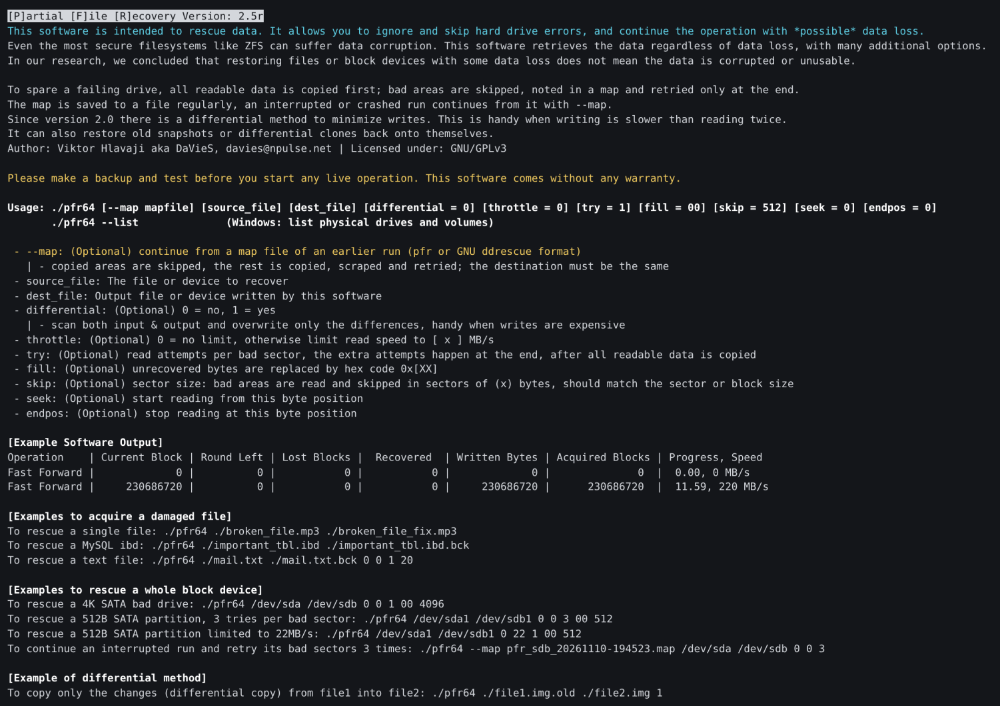
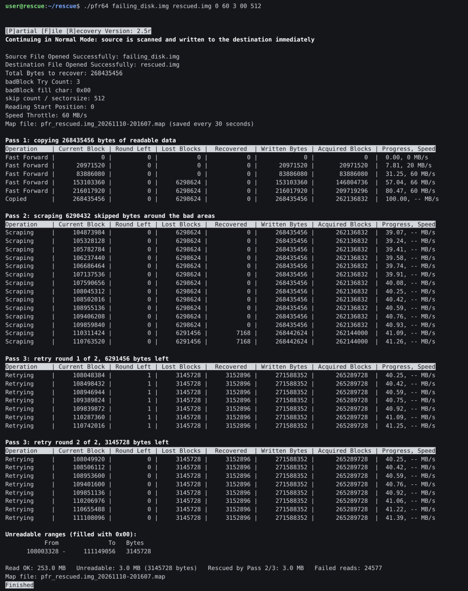
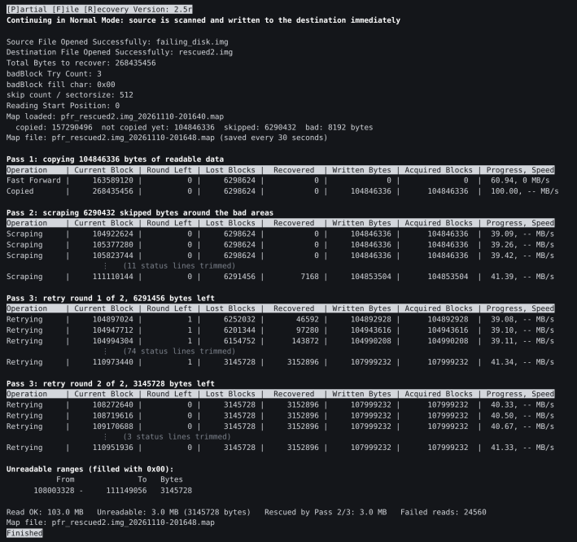

# [P]artial [F]ile [R]ecovery in case of badSector, HDD Error

## Overview

Software intended to recover, clone files or access data from a bad drive, written in pure C.
Supports Linux, FreeBSD, and Windows (MinGW-w64), including direct access to Windows physical drives and volumes.

- **All readable data is copied first.** Every failing read stresses a damaged drive, so bad areas are skipped and noted in an internal bad sector map, and only revisited once everything easy is safe:
  1. **Pass 1, Copy:** `Fast Forward` copies in 10MB chunks. On a read error it falls back to `Block Mining`: sector by sector (`skip` bytes each), **one attempt per sector**. Bad sectors in a row make it jump ahead (2, 4, 8 … up to 2048 sectors); the jumped area is marked "not tried". After clean reads it returns to Fast Forward.
  2. **Pass 2, Trim & Scrape:** each skipped area is read from its start forward and from its end backward until the first error, then its middle is read once.
  3. **Pass 3, Retry:** only now are the remaining bad sectors retried, in rounds, until `try` attempts per sector are used up. There is a small chance to succeed that way on physical hard drives.
- Sectors that **could not be recovered** are **filled with a specified character (default: 0x00)**, so the output keeps its full size and layout. This allows **partial data recovery** while covering missing data.
- At the end, the **unreadable byte ranges are listed**, together with how many failed reads the drive had to endure.
- **Differential mode** scans both source and destination, overwriting only the blocks that differ. Useful when write operations are slow or costly. Where the source is unreadable, nothing is overwritten: the destination (usually an older copy) keeps its previous content. Only the part beyond the old destination's end is filled, so the output keeps its full size.
- **Throttle** limits read speed to a specified MB/s rate, protecting fragile drives from thermal or mechanical stress.
- **Windows drive support** allows reading from and writing to `\\.\PhysicalDriveN` and `\\.\X:` paths, making it possible to write ISO images to USB drives or clone partitions directly.

## What can be recovered partially

- Block devices such as `/dev/sda`, `/dev/da0`, `\\.\PhysicalDrive0`, and so on
- InnoDB tables (`*.ibd`) — recovery is possible with small amounts of data loss, combined with `innodb_recovery_mode = 6` there is a good chance to dump the database with only a few rows missing
- Video files, MP3 files, pictures, text files, and similar formats

## What can NOT be recovered

- Deleted files
- Partitions — the software cannot alter the partition or disk layout, use `testdisk` instead

## The story behind it

- I used to solve data loss issues and wanted a tool that is easy to use and understandable
- ddrescue was too complex and a bit slower for my needs
- I wanted a tool that is native and portable (Windows, FreeBSD, Linux)

## Well proven

- Restored InnoDB databases multiple times with `innodb_recovery_mode`
- Cloned many disks with bad sectors present, then rescued data with the `testdisk` toolset
- Simpler and faster than its competitors — time is important

## Compilation

**Linux:**
```
gcc -o pfr64 pfr.c
gcc -m32 -o pfr32 pfr.c
```

**Windows (cross-compile with MinGW-w64):**
```
x86_64-w64-mingw32-gcc -Wl,--stack,4194304 -o pfr64.exe pfr.c -static
i686-w64-mingw32-gcc -Wl,--stack,4194304 -o pfr32.exe pfr.c -static
```

**FreeBSD:**
```
clang -o pfr64 pfr.c
clang -m32 -o pfr32 pfr.c
```

## Usage

```
Usage: pfr [--map mapfile] [source_file] [dest_file] [differential] [throttle] [try] [fill] [skip] [seek] [endpos]
       pfr --list              (Windows: list physical drives and volumes)
```

| Parameter    | Default | Description                                                              |
|--------------|---------|--------------------------------------------------------------------------|
| --map        |         | Continue from the map file of an earlier run (pfr or GNU ddrescue format), see [Map file](#map-file). Can be placed anywhere on the command line |
| source_file  |         | The file or device to recover from                                       |
| dest_file    |         | Output file or device                                                    |
| differential | 0       | 0 = normal copy, 1 = overwrite only differing blocks; unreadable source areas keep the destination's previous content |
| throttle     | 0       | Speed limit in MB/s (0 = unlimited)                                      |
| try          | 1       | Read attempts per bad sector; the extra attempts happen in Pass 3, after all readable data is copied |
| fill         | 00      | Hex byte (0x00-0xFF) to fill unrecoverable sectors with                  |
| skip         | 512     | Sector size used in Block Mining: read one sector at a time, fill and skip it if unreadable (should match the drive's sector/block size) |
| seek         | 0       | Start reading from this byte position                                    |
| endpos       | 0       | Stop reading at this byte position (0 = end of file)                     |

### Output

The status line shows the operation (`Fast Forward`, `Block Mining`, `Trimming`, `Scraping`, `Retrying`), the current position, the retry rounds left, the bytes currently unreadable, the bytes rescued by Pass 2/3, bytes written, bytes read successfully, and progress.

```
Pass 1: copying readable data
Operation    | Current Block | Round Left | Lost Blocks |  Recovered  | Written Bytes | Acquired Blocks | Progress, Speed
Fast Forward |             0 |          0 |           0 |           0 |             0 |              0  |  0.00, 0 MB/s
Fast Forward |     230686720 |          0 |           0 |           0 |     230686720 |      230686720  |  11.59, 220 MB/s

Pass 2: scraping 5241856 skipped bytes around the bad areas

Pass 3: retry round 1 of 2, 5243392 bytes left

Unreadable ranges (filled with 0x00 in the destination):
           From              To   Bytes
         999936 -       6243328   5243392

Read OK: 30.3 MB   Unreadable: 5.0 MB (5243392 bytes)   Rescued by Pass 2/3: 6144 B   Failed reads: 30724
```

When interrupted with Ctrl+C, the program prints the exact command to continue (`--map ...`).

### Map file

Every run writes a map file to the current directory, named `pfr_<destination>_<YYYYMMDD-HHMMSS>.map`. It is **saved every 30 seconds** while running and once more at the end. The destination is flushed to disk before each save, and the map is written to a temporary file and then renamed, so after a crash or power loss the last saved map is always valid.

The file uses CRLF line endings and the **GNU ddrescue mapfile layout**, so tools like `ddrescuelog` and `ddrescueview` can read it. The header holds the start time, the command line, the current time and the result, followed by an empty line and the map. Positions and sizes are hexadecimal; status is:

| Status | Meaning |
|--------|---------|
| `+`    | copied |
| `-`    | bad sector, filled with the fill byte (differential mode: previous destination content kept) |
| `*`    | skipped around a damaged area, not read yet, filled like `-` |
| `?`    | not copied yet (interrupted, or before `seek`) |

```
# Start time:   2026-11-10 19:45:23
# Command line: pfr src.bin out.img 0 0 3 AA 512
# Current time: 2026-11-10 19:45:23
# Mapfile. Created by [P]artial [F]ile [R]ecovery version 2.5r
# Result: Finished, 2621952 bytes unreadable
# Read OK: 34378171 bytes, Unreadable: 2621952 bytes, Not copied yet: 0 bytes, Rescued by Pass 2/3: 2627584 bytes, Failed reads: 20484
# Sector size: 512, fill: 0xAA, status: + copied, - bad sector (filled), * skipped (filled), ? not copied yet

# current_pos  current_status  current_pass
0x023493BB     +               3
#      pos        size  status
0x00000000  0x00374200  +
0x00374200  0x00280200  -
0x005F4400  0x01D54FBB  +
```

### Continuing with --map

`--map <file>` loads a map from an earlier run (pfr's own, or one written by GNU ddrescue) and continues where it stopped:

- `+` areas are skipped, they are already in the destination
- `?` areas are copied (Pass 1)
- `*` and `/` areas are trimmed and scraped (Pass 2)
- `-` bad sectors are retried in Pass 3, as many rounds as `try` allows (with `try = 1` they are left alone)

Use the same source and the same destination as the run that wrote the map. Every run writes a new map file, the loaded one is never changed.

```
pfr /dev/sda /dev/sdb 0 0 1 00 512                                   # interrupted, crashed, or finished with bad sectors
pfr --map pfr_sdb_20261110-194523.map /dev/sda /dev/sdb 0 0 1 00 512   # continue
pfr --map pfr_sdb_20261110-201200.map /dev/sda /dev/sdb 0 0 5 00 512   # later: retry the bad sectors 4 more times
```

## Examples

**Recover a damaged file:**
```
pfr ./broken_file.mp3 ./broken_file_fix.mp3
pfr ./important_tbl.ibd ./important_tbl.ibd.bck
pfr ./mail.txt ./mail.txt.bck 0 0 1 20
```

**Rescue a whole block device:**
```
pfr /dev/sda /dev/sdb 0 0 1 00 4096
pfr /dev/sda1 /dev/sdb1 0 0 1 00 512
pfr /dev/sda1 /dev/sdb1 0 22 1 00 512
```

**Windows drives (run as Administrator):**
```
pfr --list
pfr C:\image.iso \\.\PhysicalDrive1 0 0 1 00 512
pfr \\.\E: D:\backup.img 0 0 1 00 512
pfr D:\backup.img \\.\PhysicalDrive2 0 0 1 00 4096
```

Notes for Windows drives:
- Raw drives only accept whole sectors, so `skip` and `seek` (and `endpos` when reading from a drive) must be multiples of the sector size.
- An image whose size is not a multiple of the sector size is padded with the fill byte at the end.
- Every volume on the target drive is locked and dismounted before writing; afterwards Windows re-reads the partition table.
- Writing to the drive or volume that holds Windows is refused.

**Differential copy (overwrite only changed blocks):**
```
pfr ./file1.img.old ./file2.img 1
```

## Sample Output

**Help screen**



**Rescuing a disk image with a 6 MB damaged area, 3 tries:** all readable data is copied first, then the skipped area is scraped and the bad sectors are retried; half of the damaged area is rescued in the retry rounds.



**Interrupted with Ctrl+C and continued with `--map`:** the second run skips everything already copied and goes on with the rest (repeated status lines trimmed).



## License

GNU/GPLv3
